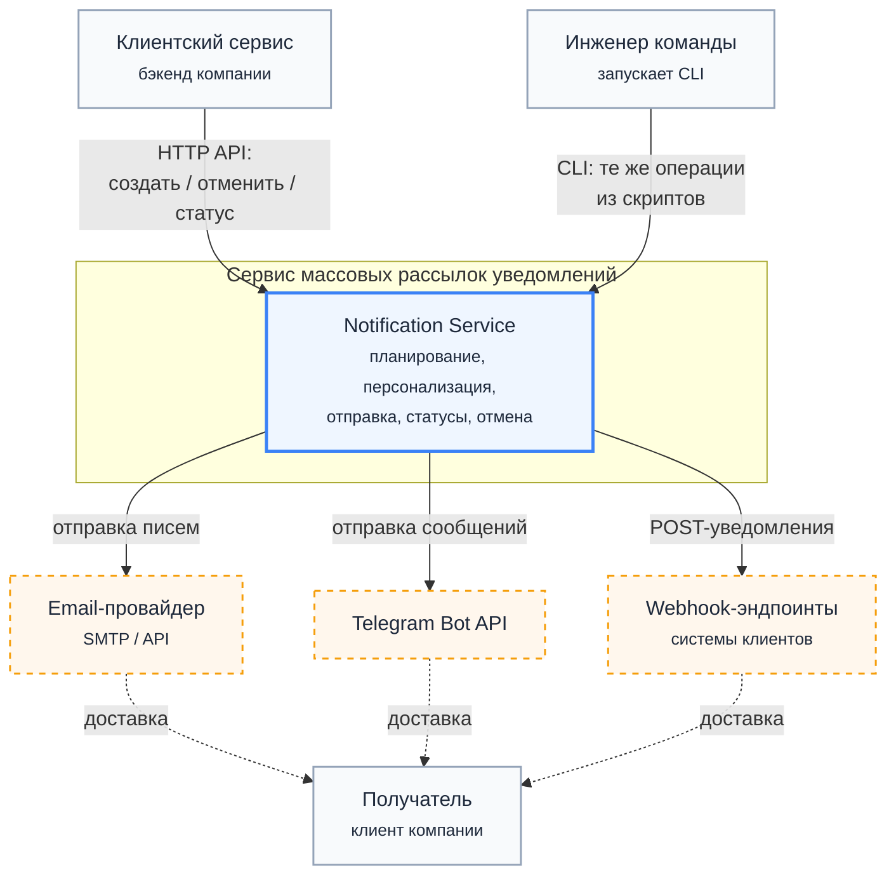
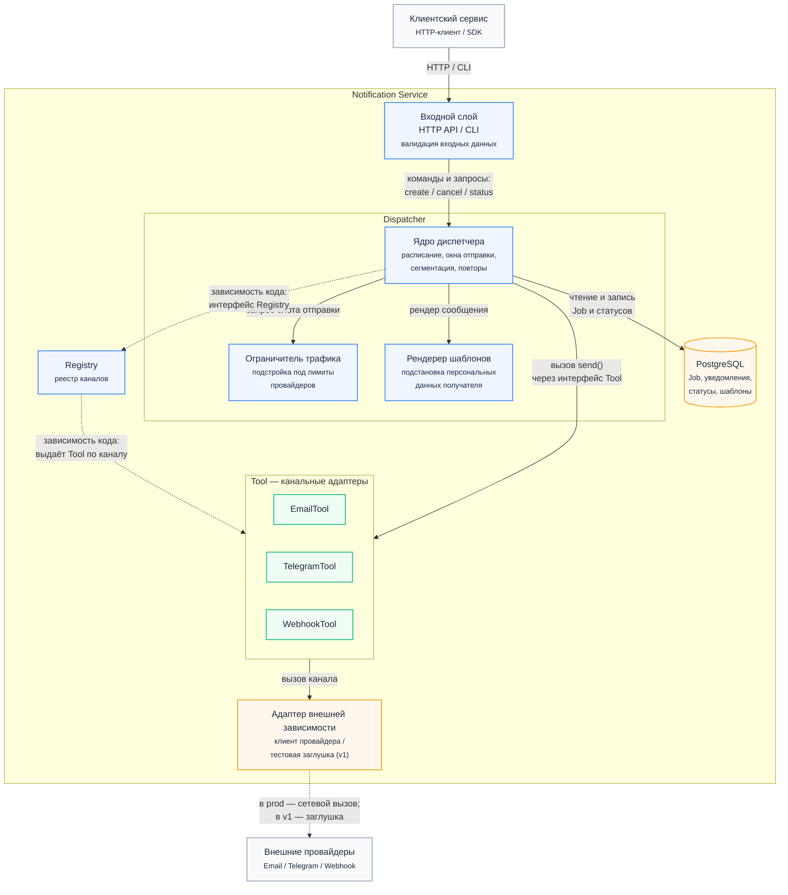
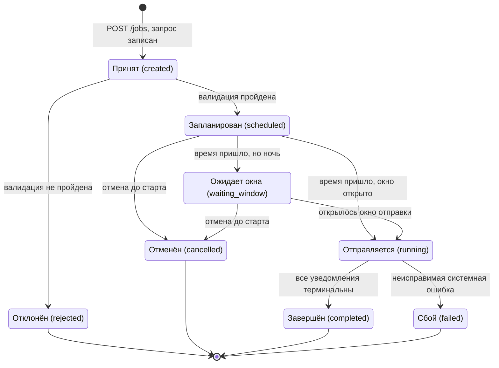
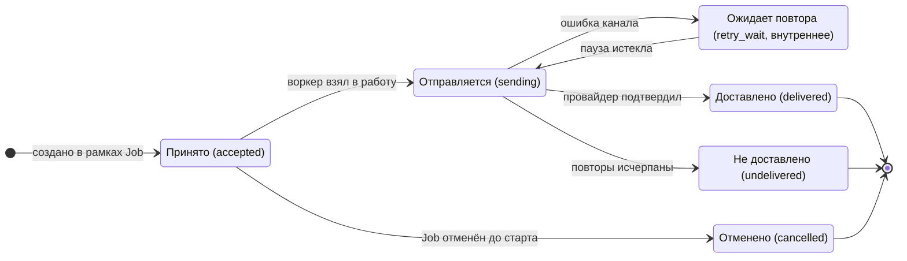

# Архитектура сервиса массовых рассылок уведомлений

Сервис принимает от клиентского бэкенда запрос на рассылку (канал, шаблон, список получателей, время запуска),
сам планирует отправку, подставляет персональные данные в шаблон, ограничивает трафик под лимиты провайдеров,
отправляет уведомления по каналам email / Telegram / webhook с ограниченными повторами и ведёт статус каждого
уведомления. Отмена рассылки возможна только до начала отправки. Конструктор писем, управление подписками,
валидация базы почт, сегментация и аналитика в первую версию не входят.

Документ содержит три схемы: контекст системы (C4, уровень Context), компоненты внутри сервиса
и машину состояний Job (рассылки). Все схемы — Mermaid, исходник лежит прямо в этом файле,
отрендеренные копии — в `docs/assets/`.

---

## 1. Контекст (уровень Context в C4)

Система целиком, её пользователи и внешние системы.

**Что показывают стрелки.** Все стрелки на этой схеме — *вызовы* (взаимодействия в рантайме): кто кого
вызывает во время работы системы. Зависимости кода на уровне контекста не показываются — здесь нет
никакого кода соседей, есть только границы систем. Сплошные стрелки — вызовы, которые инициирует наша
система или её клиенты; пунктирные — доставка уведомления до получателя силами провайдера
(наш сервис получателя не вызывает). Пунктирная рамка внешних провайдеров означает, что в первой версии
вызовы к ним заменены тестовой заглушкой — реальных сетевых вызовов нет.

| Элемент | Роль |
| --- | --- |
| Инженер команды | управляет рассылками через CLI (скрипты, cron, админ-операции) |
| Клиентский сервис | бэкенд компании-заказчика: создаёт рассылки, запрашивает статусы, отменяет через HTTP API |
| Notification Service | сама система — предмет этого документа |
| Email-провайдер, Telegram Bot API, webhook-эндпоинты | внешние каналы доставки; в v1 подменяются заглушкой |
| Получатель | клиент компании, которому приходит уведомление по одному из каналов |

**Вне границы системы (на схему сознательно не попали):** CRM-системы, обрабатывающие формы подписки;
внешние утилиты валидации базы почт; конструктор писем; аналитика открытий и кликов. Сервис с ними
не интегрируется, поэтому стрелок к ним нет — данные о получателях приходят уже внутри запроса
клиентского сервиса.

---

## Компоненты (что внутри сервиса)

**Что показывают стрелки.**

- **сплошные** — *вызовы*: взаимодействие в рантайме, во время работы сервиса (HTTP-запрос, вызов метода, SQL-запрос, сетевой вызов провайдера);
- **пунктирные** — *зависимости кода*: связь, известная уже на этапе компиляции (Dispatcher зависит только от интерфейса `Registry`, Registry — от реализаций `Tool`, адаптер скрывает за интерфейсом реального провайдера). Пунктирная стрелка от адаптера к провайдерам означает, что в v1 этой связи в рантайме нет — её закрывает заглушка.

### За что отвечает каждый компонент и что он скрывает

| Компонент | За что отвечает | Что скрывает от соседей |
| --- | --- | --- |
| Входной слой (HTTP API / CLI) | принимает create / cancel / status, валидирует входные данные и передаёт команды дальше | транспорт и формат запросов (HTTP или CLI) и детали валидации — Dispatcher получает уже проверенные команды |
| Dispatcher — ядро | планирует запуск по времени и окнам (не слать ночью), делит получателей на группы, управляет состояниями Job и повторами | алгоритмы планирования, сегментации и политики повторов — снаружи виден только результат: Job перешёл в состояние |
| Ограничитель трафика | подстраивает скорость отправки под лимиты внешних провайдеров | величину и источник лимитов — ядро просто запрашивает слот и ждёт разрешения |
| Рендерер шаблонов | подставляет персональные данные получателя в шаблон сообщения | синтаксис шаблонов и структуру данных получателя — на входе шаблон и контекст, на выходе готовый текст |
| Registry | по имени канала выдаёт нужный Tool, хранит настройки каналов | какие классы реализуют канал и как они сконфигурированы — Dispatcher знает только интерфейс |
| Tool (EmailTool, TelegramTool, WebhookTool) | единый интерфейс отправки `send()`; переводит уведомление в формат конкретного канала | протокол и API конкретного провайдера — для Dispatcher все каналы выглядят одинаково |
| Хранение (PostgreSQL) | персистентность Job, уведомлений, их статусов и шаблонов | схему БД и способ доступа — компоненты работают через репозитории, а не с SQL напрямую |
| Адаптер внешней зависимости | выполняет обращение к провайдеру; в v1 — тестовая заглушка (имитация задержек, ошибок, лимитов) | реальные endpoint'ы, ключи и формат протокола провайдера; замена заглушки на реальный клиент не требует изменений в Tool |

Поток одного запроса: клиентский сервис → входной слой (валидация) → ядро Dispatcher'а сохраняет Job в
хранилище и ждёт времени запуска → в момент запуска делит получателей на группы, рендерит тексты,
получает слоты у ограничителя трафика → через Registry берёт Tool нужного канала и вызывает `send()` →
Tool обращается к адаптеру (в v1 — заглушке) → статус каждого уведомления пишется в хранилище и доступен
через API.

Инфраструктурные задачи проекта (настройка CI, Docker Compose) на логической схеме не показаны:
Docker Compose поднимает сам сервис, PostgreSQL и заглушку провайдера, CI собирает и тестирует этот
контур, компонентного деления они не добавляют.

---

## 2. Диаграмма состояний Job

Job — одна рассылка (канал + шаблон + список получателей + время запуска), созданная одним запросом.

Значения состояний:

- **Принят** — запрос сохранён со своим id, входные данные ещё проверяются (валидация выполняется синхронно в момент создания).
- **Отклонён** — валидация не прошла; Job сохраняется для аудита, в ответе клиенту — 422 со списком ошибок.
- **Запланирован** — данные корректны, зафиксировано время запуска (например, суббота 10:00).
- **Ожидает окна** — время запуска наступило, но сейчас запрещённый интервал (ночное время); отправка стартует с открытием окна.
- **Отправляется** — идёт отправка групп получателей с ограничением трафика и повторами.
- **Завершён** — все уведомления Job получили терминальный статус (доставлено / не доставлено / отменено). Часть уведомлений может быть не доставлена — это видно в отчёте по каждому уведомлению, сам Job при этом завершён, а не сбойный.
- **Сбой** — процесс рассылки прерван неисправимой системной ошибкой (например, хранилище недоступно так долго, что продолжение невозможно). Недоступность отдельного канала к этому не приводит: она обрабатывается повторами, а исчерпавшие повторы уведомления помечаются «не доставлено», и Job корректно завершается.
- **Отменён** — клиент отменил рассылку до начала отправки.

### Разрешённые переходы

| Из | В | Событие | Что видит клиент |
| --- | --- | --- | --- |
| — | Принят | `POST /jobs` | 201 Created, `job_id`, статус `created` |
| Принят | Запланирован | валидация входных данных пройдена | статус `scheduled` при повторном запросе |
| Принят | Отклонён | валидация не пройдена (некорректный шаблон, пустой список получателей, неизвестный канал и т.п.) | 422 Unprocessable Entity со списком ошибок |
| Запланирован | Отправляется | наступило время запуска, окно отправки открыто | статус `running` |
| Запланирован | Ожидает окна | наступило время запуска, но идёт ночной интервал | статус `waiting_window` |
| Ожидает окна | Отправляется | открылось окно отправки (например, 9:00) | статус `running` |
| Запланирован / Ожидает окна | Отменён | `DELETE /jobs/{id}` до начала отправки | 200 OK |
| Отправляется | Завершён | все уведомления получили терминальный статус | статус `completed` + отчёт |
| Отправляется | Сбой | неисправимая системная ошибка | статус `failed` + причина |

Получение статуса (`GET /jobs/{id}`) разрешено в любом состоянии и состояния не меняет.

### Запрещённые переходы и ответ системы

| Попытка | Ответ системы | Почему запрещено |
| --- | --- | --- |
| Отменить Job в состоянии `running` | 409 Conflict, `{"error": "job is running, cancellation allowed only before start"}` | по требованиям отмена возможна только до начала отправки |
| Отменить Job в `completed` / `failed` / `cancelled` | 409 Conflict, `{"error": "job is already in terminal state"}` | терминальные состояния финальны, Job не «оживает» |
| Перезапустить Job из `failed` или `completed` | 409 Conflict, `{"error": "restart is not supported, create a new job"}` | повторная отправка выполняется только как новый Job; ретраи отдельных уведомлений — внутренняя механика работающего Job, а не переход состояния |
| Перевести `scheduled` → `completed` (завершить без отправки) | 405 Method Not Allowed | такой операции в API нет: завершение возможно только после отправки через `running` |
| Вернуть `running` → `scheduled` (поставить на паузу) | 409 Conflict, `{"error": "pause is not supported"}` | переход не определён; пауза не входит в первую версию |
| Изменить содержимое запланированного Job (шаблон, список) | 409 Conflict, `{"error": "job is immutable, cancel and create a new one"}` | Job неизменяем после создания — упрощает рассуждения о статусах; нужный сценарий: отменить и создать новый |

Общее правило: любые попытки перехода из терминальных состояний (`rejected`, `cancelled`, `completed`,
`failed`) и любые переходы, не перечисленные в таблице выше, отклоняются с 409 и не меняют состояние;
состояние Job меняют только события самой системы (таймер, окно, результат валидации, завершение отправки)
и отмена до старта.

### Справочно: состояния отдельного уведомления

Внутри работающего Job каждое уведомление живёт своей жизнью; Job завершается, когда все уведомления
терминальны. Внешние статусы — ровно пять из постановки: принято, отправляется, доставлено, не доставлено,
отменено. Ожидание повтора — внутреннее подсостояние, наружу отдаётся как «отправляется».

Недоступный канал не блокирует остальные: уведомления проблемного канала уходят в ожидание повтора
с нарастающей паузой, уведомления других каналов отправляются дальше; после исчерпания попыток
уведомление помечается «не доставлено», и Job в итоге корректно завершается.

---

## Как архитектура закрывает задачи проекта

| Задача | Чем закрывается |
| --- | --- |
| Отправка уведомления | Dispatcher (ядро + рендерер + ограничитель) → Registry → Tool → адаптер |
| Получение статуса уведомления | Входной слой читает через хранилище; статусы обновляет Dispatcher |
| Отмена уведомления (Job) | Входной слой + ядро Dispatcher; разрешена только до старта, см. диаграмму состояний |
| Валидация входных данных | Входной слой (синхронно при создании Job, ответ 422) |
| Обработка недоступного канала | Повторы с паузой в Dispatcher, изоляция каналов через Tool/адаптер |
| Повторная отправка уведомления | Политика повторов ядра (внутреннее состояние `retry_wait`) |
| Настройка CI, Docker Compose | Инфраструктура вокруг контура «сервис + PostgreSQL + заглушка провайдера», на компонентной схеме не отражена |
