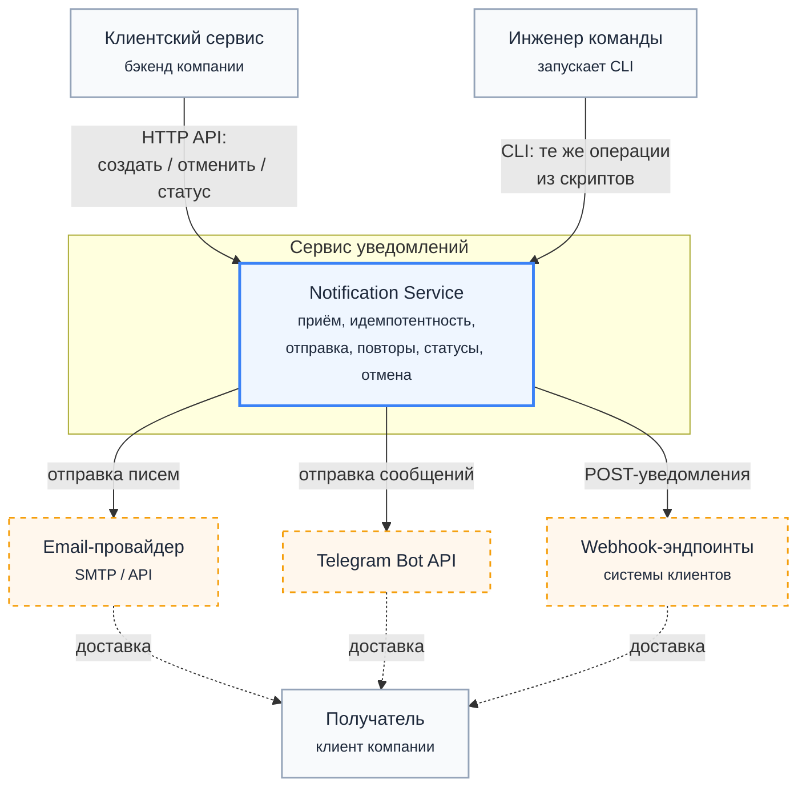
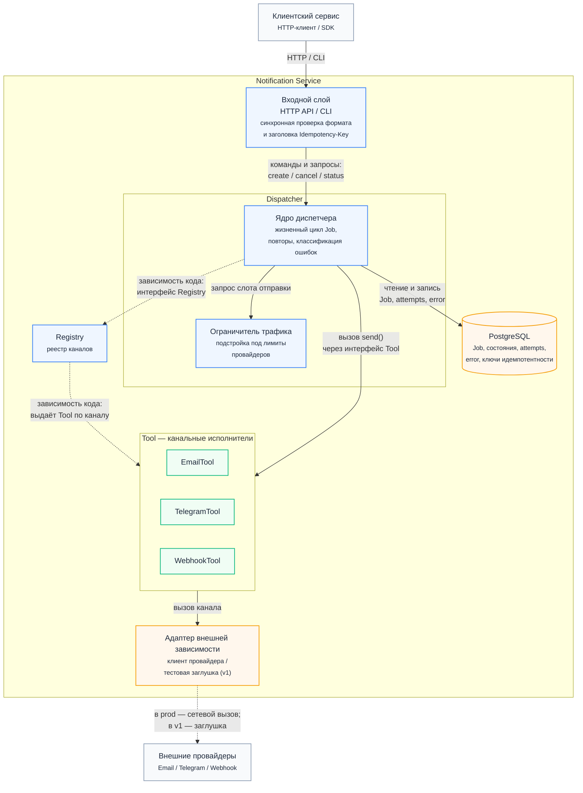
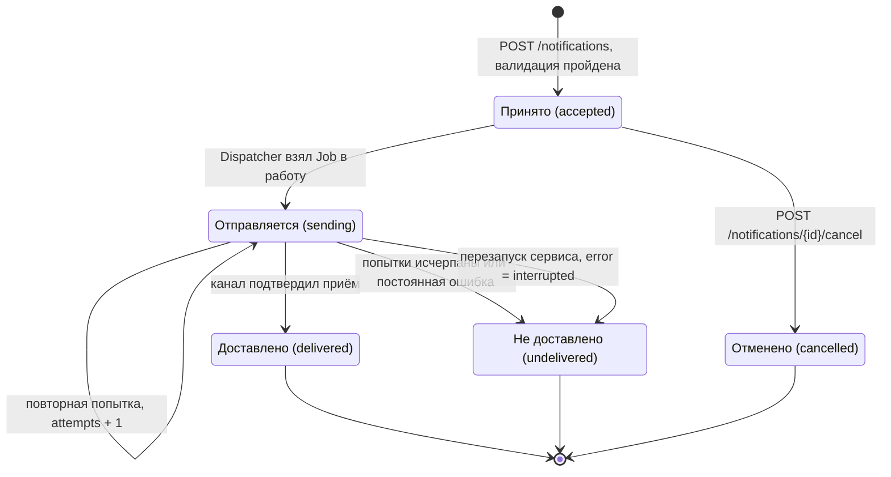

# Архитектура сервиса уведомлений

Сервис принимает от клиента (внешней системы) запрос на отправку одного сообщения — канал,
получатель, текст — и доставляет его получателю по каналам email / Telegram / webhook. Каждое
уведомление — отдельная единица работы (Job) со своим жизненным циклом: сервис ведёт статус,
повторяет временные ошибки канала ограниченное число раз, поддерживает идемпотентность создания и
позволяет отменить отправку до её начала. Гарантия доставки — не меньше одного раза. Конструктор
писем, шаблоны с переменными, рассылка по списку получателей, планирование времени запуска и окна
отправки, сегментация, аналитика и аутентификация в первую версию не входят.

---

## 1. Контекст (уровень Context в C4)

Система целиком, её пользователи и внешние системы.

**Что показывают стрелки.** Все стрелки на этой схеме — *вызовы* (взаимодействие в рантайме): кто
кого вызывает во время работы системы. Сплошные стрелки — вызовы, которые инициирует наша система
или её клиенты; пунктирные — доставка уведомления до получателя силами провайдера (наш сервис
получателя не вызывает). Пунктирная рамка внешних провайдеров означает, что в первой версии вызовы
к ним заменены тестовой заглушкой — реальных сетевых вызовов нет.

| Элемент | Роль |
| --- | --- |
| Клиентский сервис | внешняя система-заказчик: создаёт уведомления, запрашивает статусы, отменяет через HTTP API |
| Инженер команды | выполняет те же операции через CLI (скрипты, диагностика) |
| Notification Service | сама система — предмет этого документа |
| Email-провайдер, Telegram Bot API, webhook-эндпоинты | внешние каналы доставки (участник «канал» из требований); в v1 подменяются заглушкой |
| Получатель | клиент компании, которому приходит сообщение по одному из каналов |

**Вне границы системы (на схему сознательно не попали):** CRM-системы, обрабатывающие формы
подписки; внешние утилиты валидации базы почт; конструктор писем и шаблоны с переменными;
планировщик рассылок и окна отправки; аналитика открытий и кликов. Сервис с ними не
интегрируется: данные получателя приходят в самом запросе, сообщение отправляется сразу после
принятия.

---

## 2. Компоненты (что внутри сервиса)

**Что показывают стрелки.**

- **сплошные** — *вызовы*: взаимодействие в рантайме, во время работы сервиса (HTTP-запрос, вызов
  метода, SQL-запрос, сетевой вызов провайдера);
- **пунктирные** — *зависимости кода*: связь, известная уже на этапе компиляции (Dispatcher зависит
  только от интерфейса `Registry`, Registry — от реализаций `Tool`, адаптер скрывает за интерфейсом
  реального провайдера). Пунктирная стрелка от адаптера к провайдерам означает, что в v1 этой связи
  в рантайме нет — её закрывает заглушка.

### За что отвечает каждый компонент и что он скрывает

| Компонент | За что отвечает | Что скрывает от соседей |
| --- | --- | --- |
| Входной слой (HTTP API / CLI) | принимает create / cancel / status; синхронно проверяет формат запроса — канал известен, получатель подходит каналу, текст не пуст, есть заголовок `Idempotency-Key` — и отклоняет неверный запрос кодом 400 **до создания Job** | транспорт и формат запросов (HTTP или CLI) и детали валидации — Dispatcher получает уже проверенные команды |
| Dispatcher — ядро | управляет жизненным циклом Job: атомарный условный переход при отмене, запуск отправки, повторные попытки (до 3) с паузой, деление ошибок канала на временные и постоянные, обработка перезапуска сервиса | алгоритмы планирования повторов и классификации ошибок — снаружи виден только результат: состояние, `attempts`, `error` |
| Ограничитель трафика | подстраивает скорость отправки под лимиты внешних провайдеров; внутренняя механика, на контракт не влияет | величину и источник лимитов — ядро просто запрашивает слот и ждёт разрешения |
| Registry | по имени канала выдаёт нужный Tool, хранит настройки каналов | какие классы реализуют канал и как они сконфигурированы — Dispatcher знает только интерфейс |
| Tool (EmailTool, TelegramTool, WebhookTool) | единый интерфейс отправки `send()`; переводит уведомление в формат конкретного канала | протокол и API конкретного провайдера — для Dispatcher все каналы выглядят одинаково |
| Хранение (PostgreSQL) | персистентность Job, их состояний, счётчика `attempts`, причины ошибки и соответствия `Idempotency-Key` → Job | схему БД и способ доступа — компоненты работают через репозитории, а не с SQL напрямую |
| Адаптер внешней зависимости | выполняет обращение к провайдеру; в v1 — тестовая заглушка (имитация задержек, таймаутов, 5xx и постоянных ошибок) | реальные endpoint'ы, ключи и формат протокола провайдера; замена заглушки на реальный клиент не требует изменений в Tool |

Поток одного запроса (сценарий С1): клиентский сервис → входной слой синхронно проверяет формат и
заголовок `Idempotency-Key` (ошибка — 400, Job не создаётся) → ядро ищет в хранилище Job с таким
ключом: найден тот же запрос — 200 и прежний `id`, новый Job не создаётся; ключ совпал, а тело
другое — 409 `idempotency_conflict`; ключ новый — Job создаётся в состоянии «принято», клиент
получает 202 с `id` → Dispatcher берёт Job в работу («отправляется»), запрашивает слот у
ограничителя трафика → через Registry получает исполнителя канала и вызывает `send()` → Tool
обращается к адаптеру (в v1 — заглушке) → результат пишется в хранилище: «доставлено», либо
повторная попытка (`attempts` + 1), либо «не доставлено» с причиной в `error` — и доступен через
`GET /notifications/{id}`.

Инженер команды выполняет те же операции через CLI; контракт один к одному повторяет HTTP API.

Инфраструктурные задачи проекта (настройка CI, Docker Compose) на логической схеме не показаны:
Docker Compose поднимает сам сервис, PostgreSQL и заглушку провайдера, CI собирает и тестирует этот
контур, компонентного деления они не добавляют.

---

## 3. Диаграмма состояний Job

Job — одно уведомление со своим
жизненным циклом. Состояния — ровно пять из требований.

Значения состояний. Валидация формата выполняется синхронно **до создания Job**: корректный запрос
сразу создаёт Job в «принято» (клиент получает 202 и `id`), некорректный — отклоняется кодом 400,
и Job не создаётся вообще; отдельного состояния «отклонён» поэтому нет.

- **Принято** — Job создан и сохранён, отправка ещё не начиналась; единственное состояние, из
  которого возможна отмена.
- **Отправляется** — исполнитель обращается к каналу. Повторные попытки состояние не меняют: Job
  остаётся «отправляется», а счётчик `attempts` растёт (максимум 3 попытки).
- **Доставлено** — канал подтвердил приём сообщения. Терминальное.
- **Не доставлено** — попытки исчерпаны, канал вернул постоянную ошибку или сервис перезапущен;
  причина доступна клиенту в поле `error`. Терминальное.
- **Отменено** — клиент отменил отправку до её начала. Терминальное.

### Разрешённые переходы

| Из | В | Событие | Что видит клиент |
| --- | --- | --- | --- |
| — | Принято | `POST /notifications`, валидный запрос с новым `Idempotency-Key` | 202 Accepted, `id`, состояние `accepted` |
| Принято | Отправляется | Dispatcher запустил отправку (через Registry выбран исполнитель канала) | состояние `sending`, `attempts` начинает расти |
| Отправляется | Отправляется | временная ошибка канала, выполнена повторная попытка | состояние `sending`, `attempts` + 1 |
| Отправляется | Доставлено | канал подтвердил приём | состояние `delivered` |
| Отправляется | Не доставлено | попытки исчерпаны или постоянная ошибка | состояние `undelivered`, причина в `error` |
| Отправляется | Не доставлено | перезапуск сервиса | состояние `undelivered`, `error = interrupted` |
| Принято | Отменено | `POST /notifications/{id}/cancel` | 200 OK, состояние `cancelled`, сообщение не отправляется |

Получение статуса (`GET /notifications/{id}`) разрешено в любом состоянии и состояние не меняет:
возвращает состояние, `attempts` и `error`, если он есть.

### Запрещённые переходы и ответ системы

| Попытка | Ответ системы | Почему запрещено |
| --- | --- | --- |
| Отменить Job в состоянии «отправляется» | 409 `cannot_cancel` | отправка уже началась; ровно одно из двух выполняется — отмена либо отправка |
| Отменить Job в «доставлено» / «не доставлено» / «отменено» | 409 `cannot_cancel` | терминальные состояния финальны, Job не «оживает» |
| Перевести Job из терминального состояния в любое другое | 409, операций изменения нет в API | повторная отправка — только новый запрос `POST /notifications` |
| Вернуть «отправляется» → «принято» (пауза, возврат в очередь) | 409, операций изменения нет в API | переход не определён, в v1 паузы нет |
| Изменить содержимое Job (канал, получатель, текст) | 409, операций изменения нет в API | Job неизменяем после создания; нужный сценарий — отменить и создать новый |
| Создать Job с тем же `Idempotency-Key`, но другим телом | 409 `idempotency_conflict` | ключ жёстко привязан к телу первого запроса, дубль под другим содержимым запрещён |

Общее правило: любые попытки перехода из терминальных состояний («доставлено», «не доставлено»,
«отменено») и любые переходы, не перечисленные в таблице выше, отклоняются с 409 и не меняют
состояние; состояние Job меняют только события самой системы (запуск отправки, результат попытки,
перезапуск) и отмена клиентом из «принято».

### Гонка отмены и запуска отправки

Отмена и запуск отправки могут прийти одновременно. Переход «принято → отменено» выполняется
атомарно и условно — только если Job всё ещё в состоянии «принято»; иначе клиент получает 409
`cannot_cancel`. Выполняется ровно одно из двух действий: либо отмена (сообщение не уходит), либо
запуск отправки (отмена отклоняется). Промежуточных исходов «сообщение ушло, а Job отменён» нет.

### Повторные попытки и классификация ошибок канала

Ошибки канала делятся на два класса:

- **временные** — таймаут (`provider_timeout`), ответ 5xx, ответ 429, неразборчивый ответ канала:
  попытка считается неудачной (это не доставка), отправка повторяется, всего до 3 попыток;
- **постоянные** — адрес получателя не существует, бот заблокирован пользователем: повторять
  бессмысленно, Job сразу переводится в «не доставлено» с записью причины в `error`, попытки
  не тратятся.

Недоступность одного канала не влияет на другие Job: каждый Job живёт независимо и обрабатывается
своим исполнителем через Registry.

### Перезапуск сервиса и гарантия доставки

При перезапуске сервиса Job в состоянии «отправляется» переводится в «не доставлено» с
`error = interrupted` — клиент видит честный результат и может повторить отправку вручную. Гарантия
доставки — **не меньше одного раза**: если сервис упал после фактической отправки сообщения, но до
записи «доставлено», ручной повтор может дать дубль. Гарантию «ровно один раз» сервис не даёт, потому
что её нельзя обеспечить при потере подтверждения канала.

---

## 4. Как архитектура закрывает сценарии требований

| Сценарий | Чем закрывается |
| --- | --- |
| С1. Отправить уведомление | Входной слой (синхронная проверка формата) → Dispatcher → Registry → Tool → адаптер; 202 и Job «принято» |
| С2. Узнать статус | `GET /notifications/{id}` читает из хранилища состояние, `attempts`, `error`; 404 `notification_not_found` в едином формате ошибок |
| С3. Отменить уведомление | Атомарный условный переход «принято → отменено» в ядре Dispatcher; 409 `cannot_cancel` из остальных состояний и при гонке с запуском |
| С4. Некорректные входные данные | Синхронная проверка во входном слое до создания Job: 400 `unknown_channel` / `invalid_params` (с `details.field`) / `missing_idempotency_key` |
| С5. Канал недоступен | Классификация ошибок в Dispatcher: временные — до 3 попыток (`attempts` растёт), постоянные и исчерпание попыток — «не доставлено» с причиной в `error`; неразборчивый ответ — неудачная попытка |
| С6. Повторный запрос | Соответствие `Idempotency-Key` → Job в хранилище: тот же запрос — 200 и прежний `id`, тот же ключ с другим телом — 409 `idempotency_conflict` |
| Перезапуск и гарантия доставки | Перевод «отправляется» → «не доставлено» (`interrupted`) при старте; гарантия «не меньше одного раза», дубль при ручном повторе возможен |
| Машиночитаемый контракт API | `docs/api/openapi.yaml` (OpenAPI 3): все операции, коды ответов, единый формат ошибок |
| Настройка CI, Docker Compose | Инфраструктура вокруг контура «сервис + PostgreSQL + заглушка провайдера», на компонентной схеме не отражена |
